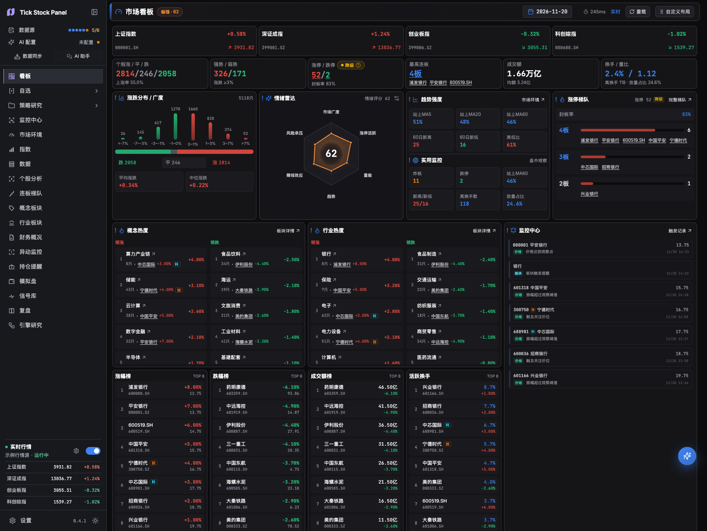
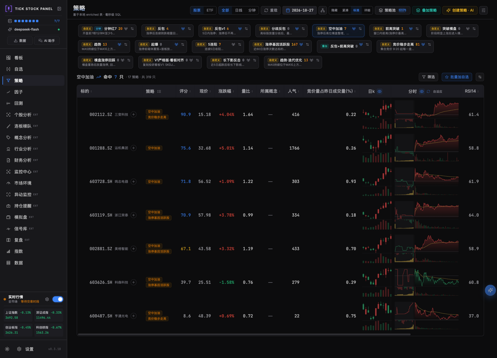
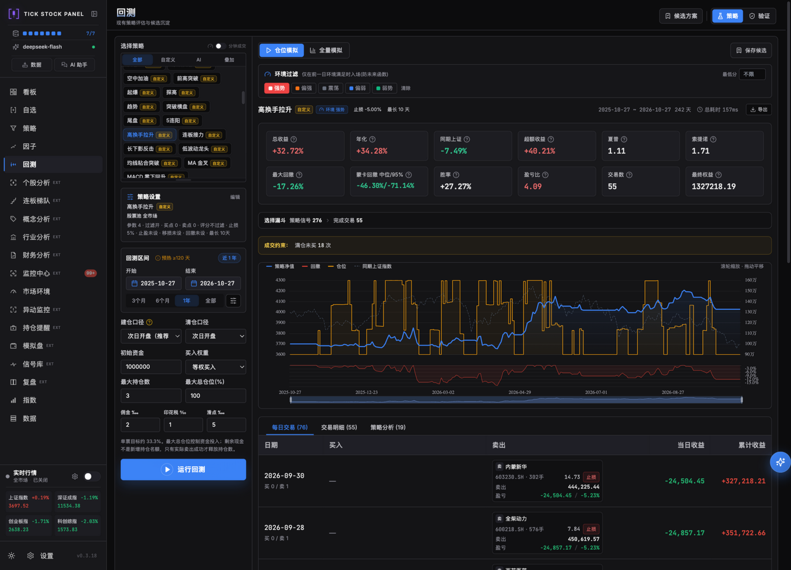
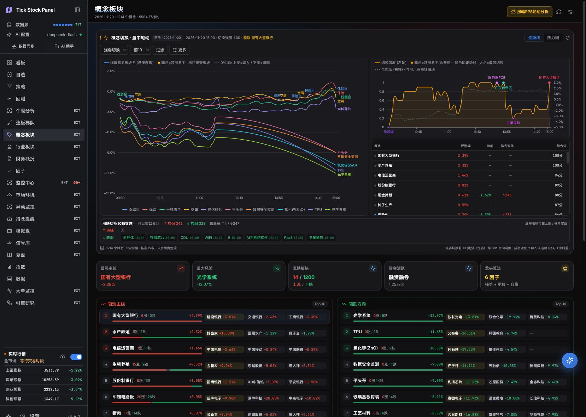

<div align="center">

<a id="top"></a>

# 📈 HS300 · A股智能量化工作台（upstream-derived）

[](./LICENSE) [](https://www.python.org/) [](https://nodejs.org/) [](https://react.dev/) [](./backend/pyproject.toml)

[核心功能](#features)　 **[快速开始](#quick-start)**　 [界面预览](#screenshots)　 [整体架构](#architecture)　 [扩展与导入](#extensions)　 [AI 接入](./docs/ai-integration.md)　 [交流群](#community-group)

</div>

---

## 🧭 HS300 项目来源与当前阶段

本仓库是 **HS300 upstream-derived 项目**，不是从零手写的量化系统。应用基线整体来自上游 tick-stock-panel；HS300 成分识别以中证指数官方接口的**当前成分**为准（动态筛选器，非固定 300 池、非月度快照），K 线、指标、图表、因子计算和回测框架均复用上游实现。

| 来源 | License | 精确版本 | 复用边界 |
| :--- | :--- | :--- | :--- |
| [`shy3130/tick-stock-panel`](https://github.com/shy3130/tick-stock-panel) | MIT | `b7892e49e256322efa1b9b9f9972d834430c77da` | 完整应用基线，排除上游 `.git/`、`.venv/`、`node_modules/`、截图目录和社区二维码 |
| [`akfamily/akshare`](https://github.com/akfamily/akshare) | MIT | `1.19.1` | 运行时依赖（pin 在 `backend/pyproject.toml`），不复制源码 |

### HS300 能力与数据限制

- **动态当前成分筛选器**：`backend/app/hs300/current.py` 经中证指数官方接口（`index_stock_cons_csindex`，东方财富降级）实时解析当前沪深300成分，结果在 `data/hs300/current_members.json` 缓存 6 小时；接口与缓存都不可用时 fail-closed 报错，绝不回退固定池。`GET /api/hs300/current` 返回 `as_of/source/count/members`。
- **应用位置**：策略回测、因子回测与筛选器均可启用「沪深300 筛选器」，对当前名单取交集运行；筛选器的单跑结果不写入全局策略缓存。
- **幸存者偏差（已知限制）**：官方只提供当前成分，历史回测按当前名单整段过滤，历史上被调出的股票不会出现；已调样的历史成分无法自动回填。
- **AkShare provider 与行情同步**：`backend/app/plugins/akshare/` 提供 A 股/指数/ETF 原始价日 K、除权因子、财报与股本变动（成交量由股转手，百分数涨跌幅转小数；复权在本地 `adj_factor` + enriched 管道）。行情由系统日 K 管线按全市场统一同步，HS300 筛选器只决定「筛谁」,不提供单独的名单同步入口。
- 上游来源、许可证和本地修改记录见 [`THIRD_PARTY_NOTICES.md`](./THIRD_PARTY_NOTICES.md)。

#### HS300 名单查询

```bash
# 当前沪深300名单（source=csindex/em/cache，6 小时内走缓存；refresh=true 强制拉取官方接口）
curl 'http://localhost:3018/api/hs300/current'
```

### 本地开发与基线验证

```bash
cd backend && uv sync --extra dev --frozen
cd backend && uv run pytest tests -q

cd frontend && pnpm install --frozen-lockfile
cd frontend && pnpm build

git diff --check
```

日常开发可继续使用上游脚本：

```bash
cp .env.example .env
./dev.sh
```

### Docker Compose

```bash
cp .env.example .env
docker compose up --build
# 打开 http://localhost:3018
```

---

<a id="project-scope"></a>

> [!IMPORTANT]
> **TSP 面向本地量化学习与研究。** 项目走独立的研究工作台路线，不对标同花顺、通达信等投资及看盘软件。AI 助手用于取数、分析和策略研究，产品范围不含 AI 荐股与涨停预测。行情数据可通过插件接入第三方来源。

---

<!-- 宽度按各截图的宽高比换算，使预览等高。 -->
<table width="100%" aria-label="界面预览">
  <tr>
    <td width="50%" align="center" valign="top">
      <strong>首页</strong><br>
      <a href="./screenshots/看板.png"></a>
    </td>
    <td width="50%" align="center" valign="top">
      <strong>策略</strong><br>
      <a href="./screenshots/策略.png"></a>
    </td>
  </tr>
  <tr>
    <td width="50%" align="center" valign="top">
      <strong>回测</strong><br>
      <a href="./screenshots/回测.png"></a>
    </td>
    <td width="50%" align="center" valign="top">
      <strong>概念分析</strong><br>
      <a href="./screenshots/概念分析.png"></a>
    </td>
  </tr>
</table>

首页截图使用演示行情。 [浏览全部界面](./screenshots/README.md)

<a id="features"></a>
<a id="-核心功能"></a>
<a id="工作台能力"></a>
<a id="在工作台做什么"></a>
<a id="why-tsp"></a>
<a id="-为什么做-tsp"></a>

## 核心功能

### 自由扩展

日 K、分钟 K、实时行情和除权因子可分别选择数据源。扩展表支持定时拉取、历史回补和 API 写入，字段可供信号、因子及回测使用。在「设置 → 导入与备份」安装数据源和页面插件，导入策略、信号、因子与图表指标。扩展页面可以和内置页面一起分组、排序。[数据源配置](./docs/configuration.md) · [扩展与导入](#extensions)

### 二次开发

用 **Page Pack SDK** 开发自有页面，复用工作台的行情接口和公共个股详情，打包上传后刷新即可使用。源码扩展可注册路由和导航，在个股详情、自选页等已开放的插槽添加组件。后端支持注册独立接口、启动钩子和通知格式化器，也可以编写自定义仓位策略。[页面 SDK](./docs/page-sdk.md) · [二次开发指南](./docs/secondary-development.md)

脚本和外部 AI 可通过 **Open API 或 MCP** 按权限读取行情、查询策略和提交回测。[AI 接入指南](./docs/ai-integration.md)

### 自研 Tivelo 引擎

- **Tivelo Data** 负责采集、校验和发布数据版本，可把日 K 与复权因子固定为快照，供策略复跑和归档研究使用。[数据引擎](./packages/tivelo-data/README.md)
- **Tivelo Backtest** 为工作台的日线、分钟策略和组合回测提供撮合与记账，按 A 股 T+1、涨跌停和交易费用等约束模拟成交。[回测引擎](./packages/tivelo-backtest/README.md)

两个引擎都提供 Python 库和命令行入口。工作台普通回测支持前复权和后复权，启用并授权 Tivelo Pro 后，A 股日线策略还可直接选择动态复权。[快照回测](./docs/engine-platform/workbench-research-jobs.md#用本地日k生成快照并回测) · [动态复权](./docs/engine-platform/workbench-research-jobs.md#动态复权扩展)

### 策略研究与盘中使用

| 功能 | 支持的操作 |
| :--- | :--- |
| **看板与个股分析** | 从榜单、连板梯队和板块成分打开个股，查看市场情绪与板块主线，配置日 K、分时指标和信息条。[市场阶段与主线](./docs/market-phase.md) · [图表指标](./docs/custom-chart-indicators.md) |
| **因子与策略** | 自定义因子并做检验、组合和挖掘，用自定义信号与策略筛选股票池。[因子与策略挖掘](./docs/mining.md) · [策略指南](./docs/strategy.md) |
| **回测验证** | 调整撮合费用、滑点和风控，进行参数筛选和滚动样本外验证，复核净值、成交和回测证据。[报告与证据](./docs/backtest-evidence.md) |
| **监控与模拟盘** | 设置价格、信号和策略告警，把策略绑定到模拟账户，跟踪订单、持仓和成交。[监控规则](./docs/features.md#-监控中心monitor) · [模拟执行](./backend/app/custom/paper_execution/README.md) |
| **工作台 AI 助手** | 在面板内查询本地行情、起草策略和运行回测。[助手与开放接口](#open-api) |

<a id="quick-start"></a>
<a id="-快速开始"></a>
<a id="install-image"></a>

## 快速开始

Docker 可直接运行工作台。行情、策略和用户配置保存在当前目录的 `data/`。

```bash
docker run -d --name tsp -p 3018:3018 \
  -e DATA_DIR=/app/data -v "${PWD}/data:/app/data" \
  ghcr.io/shy3130/tick-stock-panel:latest
```

打开 [localhost:3018](http://localhost:3018)。

<a id="install-desktop"></a>
<a id="install-compose"></a>
<a id="install-dev"></a>
<a id="configuration"></a>
<a id="️-配置"></a>
<a id="-配置"></a>

| 启动方式 | 操作 |
| :--- | :--- |
| 桌面版 | 从 [Releases](https://github.com/shy3130/tick-stock-panel/releases/latest) 下载对应平台的安装包 |
| Docker Compose | 在项目目录执行 `docker compose up --build`，按部署指南配置数据挂载 |
| 源码运行 | 安装 Python 3.11+、Node.js 20+、uv 和 pnpm，再运行 `./dev.sh` 或 `.\dev.ps1` |

[部署、升级与低配环境](./docs/deployment.md)　 [配置说明](./docs/configuration.md)　 [访问密码](./docs/deploy-password.md)

| 打开方式          | 说明                                 |
| :---------------- | :----------------------------------- |
| **悬浮球**        | 可拖动, 位置记忆; 生成中带状态指示点 |
| **侧栏「AI 助手」行** | 左上角状态区 (AI 配置行下方), 一键展开 |
| **⌘K / Ctrl+K**   | 全局快捷键随时呼出, Esc 关闭         |

**能问什么** — 21 个查询工具覆盖全站页面能力, 4 个动作工具经确认卡放行:

| 类别             | 覆盖能力                                                                                                                    |
| :--------------- | :-------------------------------------------------------------------------------------------------------------------------- |
| **个股**         | 实时行情快照(支持批量) · 日线区间 · 关键价位分析 · 财务五表(指标/利润/资负/现金流/股本)                                     |
| **大盘**         | 看板总览(涨跌家数·成交额·涨停连板·情绪雷达) · 指数行情 · 市场环境(regime) · 异动监控                                        |
| **板块**         | 概念/行业板块盘中轮动、切换事件与资金排名                                                                                   |
| **我的数据**     | 自选列表(含备注与实时涨跌) · 持仓提醒 · 信号库                                                                              |
| **策略与因子**   | 策略目录 · 执行策略取标的 · 因子目录 · 因子全市场排名                                                                   |
| **扩展内容**     | 扩展数据表(列表·字段·数据日期, 读行支持过滤/排序/日期范围) · 自定义策略与信号                                               |
| **数据健康**     | 完整性检查(日线/enriched/分钟K 覆盖区间与停更、财务表缺口、单标的滞后) · 同步任务进度                                       |
| **动作(须确认)** | 生成信号策略(声明式白名单条件, 落库即用) · 运行策略回测 · 加入自选 · 数据补全(盘后管道/财务表/分钟K扩展, 后台执行·单飞去重) |

**交互设计**

- **工具足迹卡** — 每次调用的工具名、参数、耗时、结果摘要均可展开核对; 取数可核对是设计铁律
- **动作确认卡** — 生成信号/回测/加自选/数据补全等写操作先弹确认卡(完整待执行参数可见), 你点「确认执行」才真正运行; 拒绝或 120 秒超时自动取消
- **逐字流式 + 非模态面板** — 从页面右缘滑入可拖宽(宽度记忆), 边看行情边问; 新会话带分组快捷建议, 个股问答附走势双图(日K + 分时)
- **会话历史跨设备** — 服务端注册表同步(回测/挖掘/优化/滚动任务同步接回), 本地存储降级为缓存
- **固定合规提示** — 每条回答完成后附风险提示与数据口径提示; 轮次检查点与连续执行上限可在设置调整

**扩展域的参考实现** — 后端 `app/custom/assistant/` + 前端 `src/custom/assistant/` 各自独立, 删除目录即整体卸载(见上方[架构](#-架构)); 数据补全工具与数据页共用同一条触发路径, 单飞去重天然一致。未配置 AI Key 或供应商不支持工具调用时 fail-closed, 直接提示前往设置页。

> ⚠️ 助手是数据分析工具, 不提供买卖指令; 涉及交易决策的问题会转换为客观的技术/财务状态、关键价位、风险因素与条件情景。

---

## 🚀 快速开始

<div align="center">

### 已装 Docker?用 Compose 构建并启动 ⬇️

```bash
cp .env.example .env
docker compose up --build
```

**打开 <http://localhost:3018> 即可使用。** 本地构建确保 HS300 当前成分 API 与 AkShare provider 都来自当前仓库版本；不要用上游 tick-stock-panel 镜像替代。

**还没决定要不要部署?** 先逛逛 **[官网 tsp.shy313.com](https://tsp.shy313.com/)** —— 功能总览 · 账户注册 · API Key 管理

</div>

<br/>

| 方式                                  | 适合谁                      | 前置要求                                                                             |
| :------------------------------------ | :-------------------------- | :----------------------------------------------------------------------------------- |
| **A · Compose 本地构建**              | 多数用户，拿来即用 ⭐ 推荐  | Docker                                                                               |
| **B · Dev 模式**                      | 二次开发                    | Python ≥ 3.11 · Node ≥ 20 · [uv](https://docs.astral.sh/uv/) · pnpm(`npm i -g pnpm`) |
| **C · 本机 AI 代部署**                | 完全不想碰命令行            | 任一本机 AI 编程助手                                                                 |
| **D · 桌面客户端**                    | 想要原生桌面窗口、免装环境  | Windows 10+ / macOS(Apple Silicon)                                                   |

### 方式 A:Docker Compose(本地构建,全套挂载)

```bash
cp .env.example .env
docker compose up --build
# 打开 http://localhost:3018
```

<details>
<summary>交给本机 AI 助手部署</summary>

> 请克隆 https://github.com/shy3130/tick-stock-panel，优先通过 Docker 镜像部署。需要从源码运行时，按项目部署指南启动。为数据目录设置持久化，启动后告诉我访问地址及首次配置入口。

</details>

### 第一次使用

1. 在「设置 → 数据源」选来源并检测能力。
2. 在「数据」同步日 K 和指标。需要分钟策略时，同步对应的分钟历史。
3. 创建或导入策略，先筛选，再选区间回测并保存候选。
4. 把通过验证的规则用于监控或模拟盘。外部客户端通过「设置 → 开放接口」获取对应权限的 Token。

<a id="architecture"></a>
<a id="-架构"></a>
<a id="️-架构"></a>
<a id="架构与运行流程"></a>
<a id="组件架构"></a>

```text
帮我部署 HS300 upstream-derived 项目 https://github.com/WW-shan/hs300 到本机:
克隆到当前文件夹;优先用本仓库 Docker Compose 本地构建,不要拉取 tick-stock-panel 上游镜像;
缺少的依赖(Docker / Python / Node)帮我一起装好;
最后告诉我浏览器打开哪个地址、需要填哪些 Key。
```

## 整体架构

[](./assets/readme/architecture-overview.svg)

### 方式 B:Dev 模式(二次开发推荐)

**TSP 工作台**通过登录会话管理数据源、策略和研究任务。脚本和 MCP 按 Token 权限访问开放接口。数据源、扩展表、策略与信号、页面和后端模块通过各自的契约接入工作台。[扩展与导入](#extensions) · [开放接口](#open-api)

<a id="data-engine"></a>
<a id="backtest-engine"></a>

### 方式 D:桌面客户端(Windows / macOS)

**Tivelo Data** 负责数据校验、版本发布和快照，**Tivelo Backtest** 负责应用交易规则、模拟撮合与账户记账。两者也可通过 Python 库或命令行独立使用。[数据与市场契约](./docs/engine-platform/data-and-market-contracts.md)

<a id="architecture-flows"></a>

### 数据与执行流程

[](./assets/readme/architecture-flows.svg)

普通策略回测使用工作区里的策略。A 股前复权日线回测可选用已发布的日 K 快照，启用回测过滤时会记录所用扩展数据版本。归档研究会先检查匹配的数据快照和策略归档，再提交任务。[用快照跑回测](./docs/engine-platform/workbench-research-jobs.md#用本地日k生成快照并回测)

<a id="performance"></a>
<a id="-性能"></a>

### 计算内核与性能

行情整理、指标与因子计算、回测面板准备使用 **Polars 1.44 的 Rust 列式内核**。在支持 Numba 的环境中，部分回测矩阵的滚动和递推算子使用 JIT 加速。

同机、同策略的 **15 组参数网格 A/B 基准**中，逐组独立准备与共享行情面板、矩阵编码的总耗时分别为 **19.47 秒和 6.19 秒**。两组均计入数据准备，共享后的耗时减少约 **68%**，逐笔成交及统计结果一致。[基准记录](./docs/ext-architecture-plan.md#p2a-实测2026-10-26-本机-consolidation_limit_pullback-15-组参数网格)

[技术栈与模块边界](./CONTRIBUTING.md#2-项目架构)　[引擎扩展与授权](./docs/engine-platform/extensions-and-releases.md)

<a id="extensions"></a>
<a id="开发与导入扩展"></a>

## 扩展与导入

在「设置 → 导入与备份」预览、确认资源包。源码扩展可使用前端插槽和后端注册接口。

| 要扩展什么 | 支持的接入方式 |
| :--- | :--- |
| [行情来源](./docs/plugin-development.md) | 声明 HTTP YAML，或安装根目录含 `plugin.yaml` 的 Provider ZIP |
| [扩展数据](./docs/extension-packages.md#单个扩展数据配置分享) | 导入单表配置，接入自有字段、回补和更新规则 |
| [策略、信号和因子](./docs/strategy.md#资源导入与批量导出) | 导入策略源码、定义 JSON 或带依赖的资源 ZIP |
| [图表和信息条](./docs/custom-chart-indicators.md) | 导入 `tick-chart-indicators` JSON，用公式及扩展字段定义日 K、分时和信息条 |
| [页面与菜单](./docs/page-sdk.md) | 配置分析页面或导入 `.js`／`.mjs`／`.tsx` 页面，再调整菜单分组、显隐和顺序 |
| [后端插件和仓位规则](./docs/secondary-development.md#4-后端扩展规范) | 导入带 `extension.yaml` 的后端 ZIP 后重启，在「定义目录」管理仓位算法 |
| [引擎扩展](./docs/engine-platform/extensions-and-releases.md) | 导入签名引擎 ZIP，在「已安装扩展」检查兼容性并启用 |

配置备份可迁移策略、偏好和扩展表配置。外部插件和引擎扩展用 ZIP 管理。

[导入格式与兼容性](./docs/extension-packages.md)　 [二次开发指南](./docs/secondary-development.md)

<a id="open-api"></a>
<a id="-开放能力open-api--mcp"></a>
<a id="ai-与开放接口"></a>

## AI 助手与开放接口

<a id="assistant"></a>
<a id="-ai-对话助手"></a>

- **工作台助手。** 用 `⌘K`／`Ctrl+K` 打开，可取数、起草策略和运行回测。写入由确认设置控制。
- **Open API 与 MCP。** 外部脚本和 AI 客户端可按权限访问行情、策略、扩展表与回测。

[AI 接入指南](./docs/ai-integration.md)　 [Open API 示例](./examples/open-api/README.md)　 [MCP 配置](./mcp-server/README.md)　 [策略自动迭代](./docs/strategy-iteration.md)

<a id="documentation"></a>
<a id="-完整文档"></a>
<a id="roadmap"></a>
<a id="️-路线图"></a>

## 文档与社区

[操作说明书](./操作说明书.md)　 [功能手册](./docs/features.md)　 [完整文档索引](./docs/README.md)　 [0.4.1 版本说明](./docs/release-v0.4.1.md)　 [贡献指南](./CONTRIBUTING.md)　 [版本记录](https://github.com/shy3130/tick-stock-panel/releases)

<a id="community"></a>
<a id="️-支持与交流"></a>
<a id="-支持与交流"></a>
<a id="支持与交流"></a>
<a id="社区"></a>

<details>
<summary>交流群与微信赞赏</summary>

<a id="community-group"></a>


</details>

联系邮箱 shy3130@qq.com。[项目网站](https://tsp.shy313.com/)　 [LINUX DO 社区](https://linux.do)

<a id="license"></a>
<a id="-license"></a>
<a id="许可"></a>
<a id="disclaimer"></a>
<a id="️-免责声明"></a>

## 许可与数据

TSP 工作台采用 [MIT 许可](./LICENSE)。分发副本或实质部分须保留原版权声明和许可文本。贡献请遵循 [CONTRIBUTING.md](./CONTRIBUTING.md) 的 DCO 和贡献再许可条款。

**Tivelo 组件按各自制品授权。** 采用 PolyForm 非商业许可的 Tivelo 自有实现，许可范围外的商用须另获权利人书面授权。已授予的 MIT 权利继续有效，适用范围见制品随附的 LICENSE、LICENSE-MIT 和 NOTICE。应用内可在首次配置的「查看软件许可」或「设置 → 关于 → 查看许可」查看许可声明。[PolyForm Noncommercial License 1.0.0](https://spdx.org/licenses/PolyForm-Noncommercial-1.0.0.html)

```ini
TICKFLOW_API_KEY=              # 留空 = None 模式(历史日K免费);填 Key 解锁更多
AI_API_KEY=                    # 留空 = 关闭 AI;填 Key 启用策略生成与 AI 对话助手
PORT=3018                      # 服务端口
```

> 📖 完整配置项(数据源档位、AI、服务、密码、老 CPU 兼容)见 [docs/configuration.md](./docs/configuration.md)。

---

## 🗺️ 路线图

| Phase                 | 内容                                                                                                                               | 状态          |
| :-------------------- | :--------------------------------------------------------------------------------------------------------------------------------- | :------------ |
| 0-1                   | 仓库骨架 · FastAPI 壳 · 能力探测 · K 线同步与分析页                                                                                | ✅            |
| 2-3                   | Polars enriched 流水线 · Screener · 回测引擎(T+1/手续费/止损)                                                                      | ✅            |
| 4-5                   | 监控引擎 · 四类监控规则 · 实时 SSE 推送 · 持久化记录                                                                               | ✅            |
| 6                     | 个股分析(专用日 K + 9 类关键价位 + AI 四维分析)                                                                                    | ✅            |
| **v0.2**              | 因子挖掘全链路 · 市场阶段与主线识别 · 异动监控 · 数据源插件化                                                                      | ✅            |
| **v0.3**              | 能力路由矩阵 · fuyao 数据源(财务/龙虎榜/风向标) · 分钟策略与回测 · 交易日探针 · 全时段异动中心 · 回测导出与候选复测                | ✅            |
| **AI 助手**           | 对话式数据问答与操作: 21 查询 + 4 动作工具(确认卡放行, 含生成信号/回测/加自选/数据补全) · 逐字流式 + 工具足迹卡 · 完全解耦扩展模块 | ✅            |
| **v0.3.2 开放能力版** | API Token + 六档 scope 网关 · 61 端点契约(快照+CI 守护) · 扩展数据读写闭环 · SSE 事件流 · MCP 服务器 · 核心/扩展域边界标注         | ✅            |
| **v0.3.6**            | [TdxQuant](https://help.tdx.com.cn/quant/) 数据源(realtime/五档/日K/复权/分钟) · 11 官方页面单文件扩展化 + 运行时页面插件 · 扩展表两级拉取配方(概念/行业出厂即用) · AI Responses 协议与会话跨设备 · 情绪评分口径可配置 · 财务画像手动拉取 · 策略池叠加分组 · 65 端点契约 | 🚧          |
| **v0.3.7**            | 模拟盘重构(多账户对比·策略自动执行) · 桌面修复(TdxQuant Key 探测·macOS 数据目录移出 .app 包) · 界面缩放 transform scale 修复 · 策略安全校验加固(GH #475) · 68 端点契约 | 🚧          |

---

## 📚 完整文档

| 文档                                                                                               | 内容                                                                 |
| :------------------------------------------------------------------------------------------------- | :------------------------------------------------------------------- |
| [docs/deployment.md](./docs/deployment.md)                                                         | 部署方式(Dev / Docker / GH Actions)、老 CPU 兼容、更新代码、访问密码 |
| [docs/configuration.md](./docs/configuration.md)                                                   | 所有 `.env` 配置项详解(数据源、AI、服务、密码、数据目录)             |
| [docs/features.md](./docs/features.md)                                                             | 各功能模块详细说明(策略/指标/回测/监控/个股分析/数据扩展/开放接口)   |
| [docs/open-platform-plan.md](./docs/open-platform-plan.md)                                         | 开放平台设计:核心域/扩展域边界、Token 体系、Tier 契约与分期路线      |
| [mcp-server/README.md](./mcp-server/README.md)                                                     | MCP 服务器配置(AI 客户端接入)与工具清单                              |
| [examples/open-api](./examples/open-api/README.md)                                                 | 开放接口可运行示例(行情/写入/回测/事件流)                            |
| [docs/custom-data-source.md](./docs/custom-data-source.md)                                         | 自定义数据源接入、能力路由契约、YAML 配置与 mock 联调示例            |
| [docs/strategy.md](./docs/strategy.md)                                                             | 策略体系(全自定义化 + 三种扩展方式 + 文件结构)                      |
| [docs/strategy-iteration.md](./docs/strategy-iteration.md)                                         | AI 策略迭代协议:台账 / 证据包 / 门槛判定 / 提示词卡片                |
| [docs/mining.md](./docs/mining.md)                                                                 | 因子与策略挖掘口径、防泄漏、任务隔离和发布边界                       |
| [docs/market-phase.md](./docs/market-phase.md)                                                     | 市场情绪周期 6 阶段与概念/行业主线识别的口径与设计                   |
| [docs/plugin-development.md](./docs/plugin-development.md)                                         | 数据源插件开发规范(以 fuyao 为参考实现)                  |
| [docs/secondary-development.md](./docs/secondary-development.md)                                   | 代码二次开发、前端插槽、后端策略接口与 AI 开发模板                   |
| [docs/page-sdk.md](./docs/page-sdk.md)                                                             | 页面插件开发指南:产物契约、能力桥 ctx、打包与上传、安全边界           |
| [backend/app/strategy/prompts/strategy-guide.md](./backend/app/strategy/prompts/strategy-guide.md) | 策略开发完整规范(AI 生成与手写)                                      |

## ⚠️ 免责声明

本项目仅供**学习与量化研究**,**不构成任何投资建议**。回测结果不代表未来收益。A 股有风险,入市需谨慎。数据准确性以数据源官方为准。

## 📄 License

[MIT](./LICENSE) © tick-stock-panel contributors

HS300 基线复用 MIT 的 AkShare 1.19.1；成分识别直接调用中证指数官方公开接口，不再随仓库引入固定成分快照数据集。完整来源记录见 [`THIRD_PARTY_NOTICES.md`](./THIRD_PARTY_NOTICES.md)。

> **分发与二次开发须知**:依据 MIT 协议,分发本软件或其任何部分(包括 fork 后发布、修改再发布、封装为自有产品或服务)时,必须完整保留原始版权声明与许可文本。未经版权所有者书面许可,移除、遮蔽或篡改版权署名、许可声明,或在再分发时隐匿本项目来源,均构成协议违约与著作权侵权,版权所有者保留依法追究责任的权利。
>
> 协议全文与第三方组件许可清单亦可见应用内「设置 → 关于 → 开源许可」。

本项目依赖 [TickFlow](https://tickflow.org/auth/register?ref=V3KDKGXPEA) 提供数据服务,使用前请遵守其服务条款

内置数据源插件 [fuyao](https://fuyao.aicubes.cn/docs/api-reference/) 提供同花顺 REST 数据接口(行情 / 财务 / 龙虎榜 / 盘前风向标 / 交易日历等),需自备 API Key,使用前请遵守其服务条款

内置数据源插件 [TdxQuant](https://help.tdx.com.cn/quant/) 提供通达信量化数据服务(实时行情 / 五档盘口 / 日K / 复权因子 / 分钟K),需自备 API Key,使用前请遵守其服务条款

## 社区

本开源项目已链接并认可 [LINUX DO 社区](https://linux.do)。

---

<div align="center">

**⭐ 觉得有用?点个 Star 就是最大的支持 · fork 时也请顺手点个 star**

**[⬆️ 回到顶部](#top)**

</div>

本项目仅供学习与量化研究，回测结果不代表未来收益，不构成投资建议。使用数据前请阅读供应商条款。[TickFlow](https://tickflow.org/auth/register?ref=V3KDKGXPEA) · [fuyao](https://fuyao.aicubes.cn/docs/api-reference/) · [TdxQuant](https://help.tdx.com.cn/quant/)
